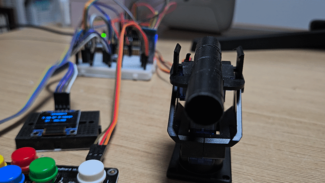
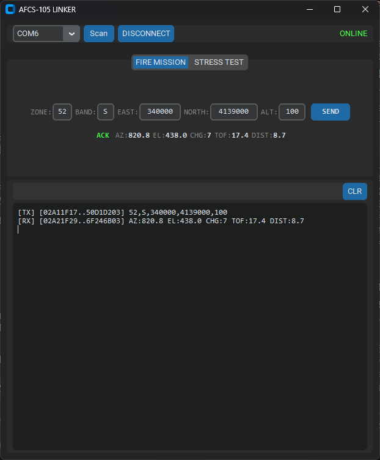
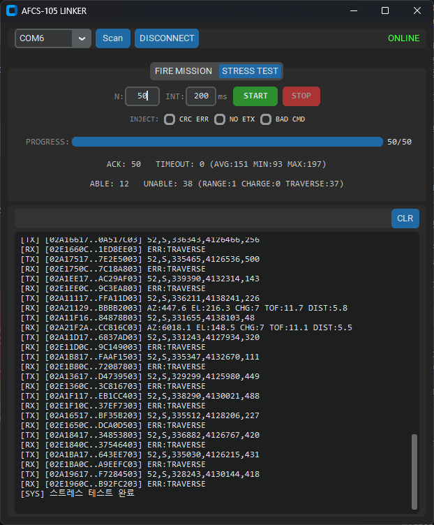
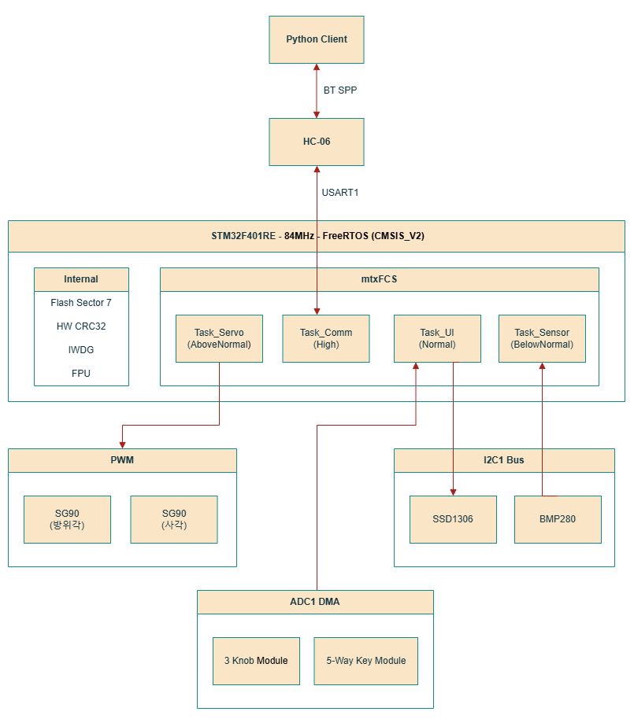
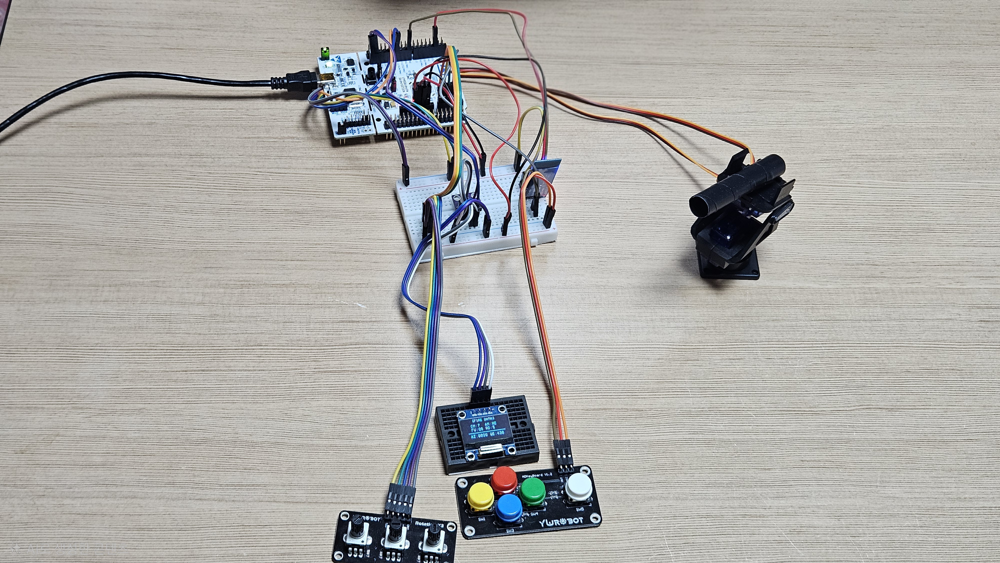
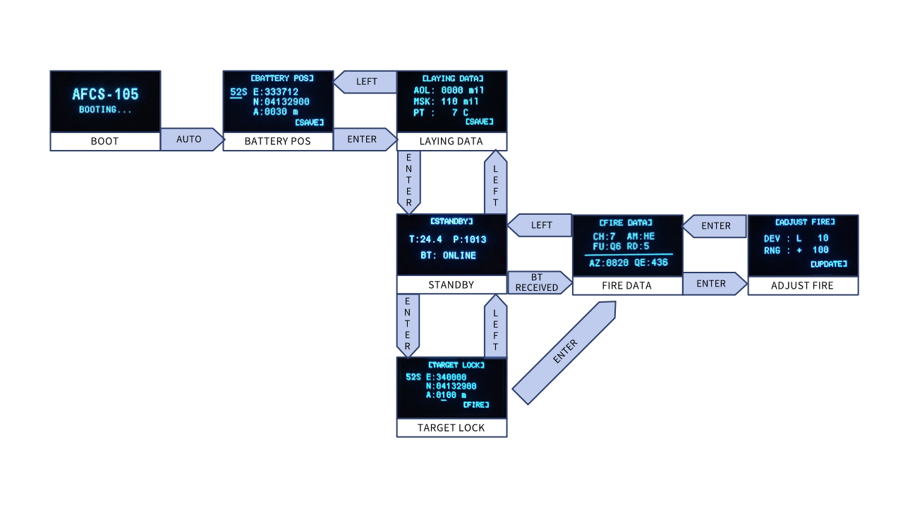

# AFCS-105

K105A1 105mm 사격통제장치 시뮬레이터<br>
C 약 3,000줄 · STM32 + FreeRTOS<br>
블루투스 표적좌표 수신 → 탄도 제원 계산 → OLED 표시 + 서보 포신 구동

<div align="center">



 

</div>

---

## 핵심 기능

- 실시간 탄도 계산 - 장약 7종 사표 보간, 환경 5요소 보정, 장약 자동선택
- 양방향 암호화 바이너리 통신 프로토콜
- FreeRTOS 4-태스크 실시간 제어
- 서보 2축 포신 지향 (슬루잉, 전이한계 판정)
- Flash 설정 영속 저장 (dirty-check, CRC-32 검증)
- 다중 방어 계층 - IWDG, Fault Handler, Stack Overflow Detection

---

## 아키텍처

<div align="center">



</div>

---

## 하드웨어

<div align="center">



</div>

<div align="center">

| 부품 | 역할 | 사양 |
|------|------|------|
| STM32F401RE (Nucleo-64) | Cortex-M4F 84MHz, FPU | 512KB Flash, 96KB RAM |
| SSD1306 OLED 128×64 | 상태 표시 디스플레이 | I2C1 (PB8/PB9) |
| BMP280 | 기온/기압 센서 | I2C1 (PB8/PB9) |
| HC-06 | 블루투스 UART | USART1 9600baud (PA9/PA10) |
| 로터리 노브 ×3 | 방열방위각 / 장약온도 / 장약 | ADC1 DMA (PA0/PA1/PA4) |
| 5방향 키 | UI 내비게이션 | ADC1 전압 분배 (PB0) |
| SG90 서보 ×2 | 방위각 / 사각 구동 | TIM3 PWM 50Hz (PA6/PA7) |

</div>

---

## 소프트웨어 구조

```
AFCS-105/
├── Core/
│   ├── Inc/                헤더
│   └── Src/
│       ├── freertos.c      FreeRTOS 4-태스크 구현
│       ├── fcs_core.c      프로토콜 파서 + 암호화
│       ├── ui.c            7단계 FSM + OLED 렌더링
│       ├── fcs_math.c      탄도 계산
│       ├── fcs_lut.c       UTM↔WGS84 변환 (Q1.30 LUT+FPU)
│       ├── flash_ops.c     Flash 영속성 (Sector 7, CRC-32)
│       ├── ssd1306.c       OLED I2C 드라이버
│       ├── servo.c         서보 매핑 + 슬루잉
│       ├── bmp280.c        BMP280 센서 드라이버
│       ├── input.c         5방향 아날로그 키 스캐너
│       ├── crc.c           HW CRC-32 래퍼
│       ├── main.c          초기화, DWT, IWDG
│       └── stm32f4xx_it.c  Fault Handler + ISR
├── ClientApp/
│   └── fcs_terminal.py    블루투스 사격요구 클라이언트 (CustomTkinter)
├── Tools/
│   └── gen_sinlut.py      Q1.30 sin LUT 생성기
├── FCS.ioc                CubeMX 프로젝트
└── STM32F401RETX_FLASH.ld 링커 스크립트
```

---

## UI 상태머신

<div align="center">



</div>

---

## 기술 요약

<div align="center">

| 항목 | 내용 |
|------|------|
| 연산 방식 | HW FPU, 삼각함수 Q1.30 LUT |
| RTOS | FreeRTOS CMSIS_V2, heap_4, 20KB |
| 탄도 계산 성능 | ~3,300 cycles / 40μs (Release -O2) |
| 통신 | Rolling XOR + HW CRC-32 양방향 암호화 패킷 |
| Flash 영속성 | Sector 7, 매직코드 + CRC-32 검증, dirty-check |
| 방어 계층 | IWDG, Fault Handler, Stack Overflow Detection |
| Flash | ~55.4KB (10.8% / 512KB) |
| RAM | ~27.9KB (29.0% / 96KB) |

</div>

---

## 검증

<div align="center">

| 항목 | 방법 | 결과 |
|------|------|------|
| 통신 안정성 | Python 클라이언트 1,000회 스트레스 테스트 | 전 회차 정상 응답 |
| 오류 주입 | CRC 변조 패킷, ETX 누락 프레임 전송 | ERR 응답 + 파서 자동 복구 확인 |
| 정적 분석 도구 | cppcheck 2.20 --enable=all --std=c99 | warning 0건 |
| 코드 인스펙션 | MISRA-C 참고 자체 18개 규칙 기준표 | 위반 0건 |
| 런타임 방어 | IWDG, Fault Handler, Stack Overflow Detection | 정상 동작 확인 |

</div>

---

## 주요 최적화

- **문제:** Cortex-M4F 단정밀도 FPU만 탑재, double 소프트웨어 에뮬레이션으로 1,100μs 소요
- **해결:** double→float 전환(HW FPU 활용) + UTM↔WGS84 변환 삼각함수 Q1.30 sin LUT 하이브리드
- **결과:** 1,100μs → 40μs (약 28배), UTM↔WGS84 좌표 변환 오차 1m 이내 (살상반경 30m 대비 3.3%)

---

## 빌드

### 펌웨어
1. `FCS.ioc` → STM32CubeMX → Generate Code
2. STM32CubeIDE → Release 빌드 (-O2)
3. ST-LINK 플래시

> Drivers/, Middlewares/는 .ioc에서 재생성되므로 레포에 미포함.

### 클라이언트
```bash
pip install customtkinter pyserial
python ClientApp/fcs_terminal.py
```

---

## 저자

윤오름

## 라이선스

MIT License
